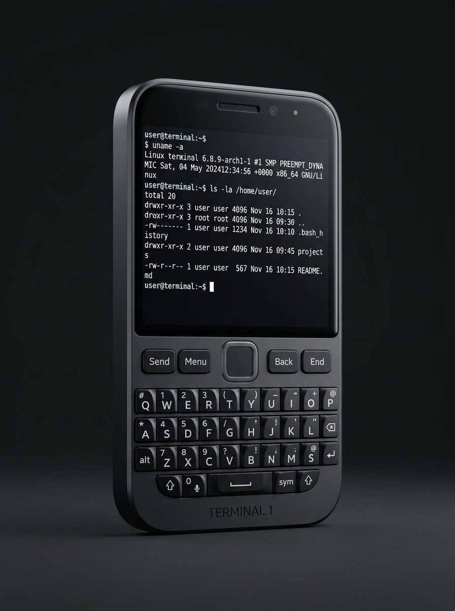

<div align="center">



# Terminal 1

**A pocket Linux terminal with a real keyboard.**
Square 720 × 720 screen · BlackBerry Q20 keyboard and trackpad · Raspberry Pi CM4 · USB-C · carbon fibre back

[Website](https://mmuhlariholdings.github.io/terminal-1/) · [Product plan](system/plan/product-plan.md) · [3D model (Onshape)](https://cad.onshape.com/documents/8bfe7e43f7d7ec8135f9a829/w/29c38cad0998e4a6472b08e0/e/69201118ddf43601f28283ef) · [Contribute](CONTRIBUTING.md)

</div>

> [!IMPORTANT]
> **This project is vibe coded.** The plan, CAD, schematics, board layouts, firmware, Linux setup, docs and website are written
> largely by an AI coding assistant (Claude Code), directed and reviewed by humans. **Nothing has been built or tested on real
> hardware yet.** Treat every number as an estimate until a datasheet or a bench test confirms it. Items not yet verified are
> marked `CHECK` or *verify*. Checking them is one of the most useful contributions you can make. Why we work this way:
> [decision 0010](docs/decisions/0010-built-openly-with-an-ai-coding-assistant.md).

---

Terminal 1 does one job well: **working in a shell** on the go. SSH, `az login --use-device-code`, Claude Code, git, tmux,
everyday Linux. It boots straight into a full-screen terminal: no desktop, no browser, no notifications. Wi-Fi plus your
phone's hotspot covers connectivity.

It is a learning project first: KiCad, PCBs from JLCPCB and PCBWay, sourcing, 3D printing, carbon composites and Linux. We buy
proven modules where building them would teach little (the CM4 and the keyboard) and design our own boards around them.

## At a glance

| | |
|---|---|
| **Screen** | 4-inch 720 × 720 IPS, MIPI DSI: **90 × 45 characters** with an 8 × 16 font |
| **Keyboard** | BlackBerry Q20 replacement keyboard + trackpad; Ctrl / Esc / Tab / Fn above the keys; trackpad as arrow keys |
| **Computer** | Raspberry Pi Compute Module 4: 4 × Cortex-A72, 4 GB RAM, 32 GB eMMC, Wi-Fi 5, Bluetooth 5 |
| **Software** | Raspberry Pi OS Lite 64-bit · cage + foot · zsh · tmux · NetworkManager · Azure CLI · Node.js 22 · Claude Code |
| **Power** | 1S LiPo about 4,000–4,500 mAh, USB-C charging, runs while charging; about 4–6 h of terminal use (estimate) |
| **Size** | 84 × 150 × 19 mm, about 291 g (from the CAD model) |
| **Build** | Black aluminium mid-frame, carbon fibre back with a fibreglass radio window |
| **Our boards** | Keyboard and power board (RP2040, BQ25895, 5 V boost, MAX17048) · CM4 carrier board (4 layers, DSI, RTC) |

## Status

**Phase 0 (bench prototype) is next. First design pass done on 2026-11-16.**

| Area | State | Where |
|---|---|---|
| Plan | Converted to a living plan, decisions recorded | [`system/plan/`](system/plan/) · [`docs/decisions/`](docs/decisions/README.md) |
| 3D model | Full stack modelled in Onshape (FeatureScript), regenerates; fit check done | [`hardware/enclosure/`](hardware/enclosure/README.md) |
| Keyboard and power board | Generated schematic and board, first pass (see its README for ERC / DRC status) | [`hardware/keyboard-board/`](hardware/keyboard-board/) |
| CM4 carrier board | Generated schematic and board, first pass; high-speed routing needs hands | [`hardware/carrier-board/`](hardware/carrier-board/) |
| Keyboard firmware | Written for RP2040 (Pico SDK + TinyUSB); not yet run on hardware | [`firmware/keyboard-board/`](firmware/keyboard-board/) |
| Linux | Installer, configs and status daemon written and unit tested; not yet run on a CM4 | [`linux/`](linux/README.md) |
| Website | Static launch page with the 3D model | [`website/`](website/README.md) |

## Roadmap

| Phase | What | Gate |
|---|---|---|
| **0 · Bench prototype** ← *we are here* | CM4 on its IO board, Q20 keyboard on a Pico, screen on the desk | SSH, `az login` and Claude Code from the bench keyboard |
| 1 · Keyboard and power board | Our RP2040 board from JLCPCB | Reliable typing, safe charging, clean shutdown from the power button |
| 2 · Carrier board | Our 4-layer CM4 carrier | Boots from the battery with screen and Wi-Fi |
| 3 · Enclosure | Printed shell → aluminium mid-frame → carbon back | Fits a jacket pocket, stays cool, Wi-Fi works with the back on |
| 4 · Daily driver | Battery tuning, disk encryption, key map refined | Two weeks without reaching for the laptop |
| 5 · Terminal 2 | Modem, bigger battery, optional CM5 | |

## Repository map

```
system/plan/          product-plan.md (the living plan) · interfaces.md (shared numbers) · the original PDF
docs/                 conventions.md · decisions/ (why things are the way they are) · media/ (renders)
hardware/enclosure/   terminal-1.fs (the Onshape model as code) · build sheet · .glb export
hardware/keyboard-board/   RP2040 keyboard and power board: generators, KiCad project, Gerbers, build sheet
hardware/carrier-board/    CM4 carrier: generators, KiCad project, routing notes, build sheet
firmware/keyboard-board/   RP2040 firmware (key map, trackpad, USB, power state machine) + host tests
linux/                install.sh, configs, terminal-1-statusd, pi-gen image stage
tools/                shared Python generators (KiCad schematic writer, board builder, checks)
website/              the launch page (static, GitHub Pages)
```

## Getting started

| You want to… | Start here |
|---|---|
| Understand the device | [Product plan](system/plan/product-plan.md), then [interfaces](system/plan/interfaces.md) |
| Look at the 3D model | [Onshape document](https://cad.onshape.com/documents/8bfe7e43f7d7ec8135f9a829/w/29c38cad0998e4a6472b08e0/e/69201118ddf43601f28283ef) and [`hardware/enclosure/`](hardware/enclosure/README.md) |
| Build the Phase 0 bench prototype | [`linux/README.md`](linux/README.md) and [`firmware/keyboard-board/README.md`](firmware/keyboard-board/) |
| Regenerate a schematic | `python3 hardware/<board>/electronics/generate_schematic.py --erc` (KiCad 10 installed) |
| Run the checks locally | `python3 tools/check_decisions.py` · `python3 -m unittest discover -s linux/status-daemon/tests` |
| Preview the website | `python3 -m http.server -d website/public 8000` → http://localhost:8000 |

Tools: git, Python 3, [KiCad 10](https://www.kicad.org/) (schematics, boards; its Python runs the board scripts), Java 21 (the
Freerouting autorouter), the [Pico SDK](https://github.com/raspberrypi/pico-sdk) and an Arm GCC toolchain (firmware), an
[Onshape](https://www.onshape.com/) account (free for public documents).

## Contributing

Everyone is welcome: electronics, CAD, firmware, Linux, docs, design, or simply **checking a datasheet against our files**.
Read [`CONTRIBUTING.md`](CONTRIBUTING.md), pick an issue labelled
[`good first issue`](https://github.com/mmuhlariholdings/terminal-1/labels/good%20first%20issue), and open a pull request.
Please follow the [Code of Conduct](CODE_OF_CONDUCT.md). Security issues: [`SECURITY.md`](SECURITY.md).

## Standing on shoulders

Beepy (SQFMI), Hackberry Pi, Solder Party's BBQ20KBD, ClockworkPi uConsole and MNT Pocket Reform showed the way; Raspberry Pi
publishes the CM4 IO board design we base our carrier on. Thank you.

## Licence

Hardware **CERN-OHL-S-2.0**, software **MIT**, documentation **CC BY-SA 4.0**. See [`LICENSE`](LICENSE). Terminal 1 is not
affiliated with Raspberry Pi Ltd or BlackBerry Ltd; their names are used only to describe the parts used.
