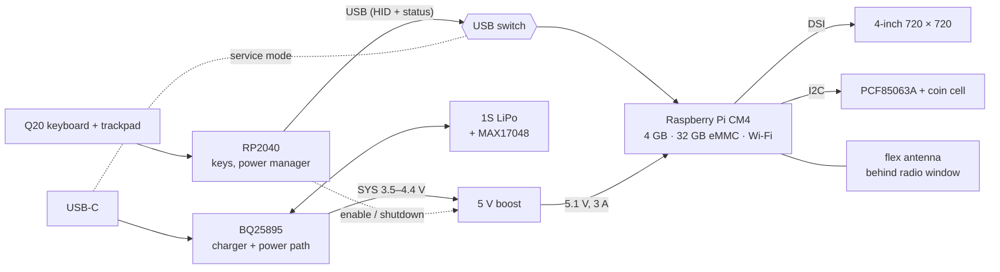

# Terminal 1: product plan

**Version:** 1.2 (2026-11-17) · **Owner:** project owner · **Status:** Phase 0 (bench prototype) not started; first design pass done
**Source:** converted from `terminal-1-prototype-plan.pdf` (v1.0, 2026-11-16) and kept here as the living plan. Changes go in the
changelog at the end. Why each major decision was made: [`docs/decisions/`](../../docs/decisions/README.md). Shared numbers
(sizes, pin maps, protocols): [`interfaces.md`](interfaces.md).

> Numbers in this plan are estimates unless a test says otherwise. Costs are in South African rand, from memory, not quotes, and
> could be 30–50 % off. This project is designed with an AI coding assistant ([decision 0010](../../docs/decisions/0010-built-openly-with-an-ai-coding-assistant.md)).

---

## 1. Overview

Terminal 1 is a **pocket Linux terminal in the BlackBerry form factor**: a square screen on top, a real hardware keyboard below,
and nothing else. It exists to do one job well, which is working in a shell: SSH, `az login`, Claude Code and everyday Linux
work on the go.

It is a **learning project first**. We build it in-house to practise the full chain: KiCad, PCBs made by JLCPCB and PCBWay,
sourcing, 3D printing, carbon composites and Linux. We buy proven modules where building them would teach little (the processor
module and the keyboard) and design our own boards around them. Selling it comes later, if ever. It is open source so others can
learn from it and build it too.

## 2. Requirements

| Priority | Requirement | How we check it |
|---|---|---|
| Must | A BlackBerry-style hardware keyboard with a trackpad | Phase 1 gate |
| Must | A screen that fits a usable terminal, about 80 columns | 90 × 45 at 720 × 720 with an 8 × 16 font (Phase 0) |
| Must | 64-bit Linux on an Arm processor, with Wi-Fi | Phase 0 gate |
| Must | Runs SSH, Azure CLI and Claude Code comfortably | Phase 0 gate |
| Must | Battery powered, charged over USB-C, about 4 hours or more of use | Phase 4 measurement |
| Must | Fits in a jacket pocket | Phase 3 gate |
| Nice to have | Keyboard backlight; a trackball for the classic BlackBerry feel | |
| Not in v1 | Camera, speaker, microphone, touchscreen or mobile network (Wi-Fi plus a phone's hotspot covers connectivity) | |

## 3. Projects to learn from

From memory up to mid-2026; check each project's current status.

| Project | What it is | What we learn from it |
|---|---|---|
| Beepy (SQFMI) | BlackBerry keyboard, Sharp memory screen, Raspberry Pi Zero | Keyboard drivers, terminal-first Linux |
| Hackberry Pi | BlackBerry keyboard with a 720 × 720 square screen on a Raspberry Pi | Almost exactly our layout; screen and enclosure |
| Solder Party BBQ20KBD | Open board running a BlackBerry Q20 keyboard and trackpad from an RP2040 | The basis for our keyboard controller |
| ClockworkPi uConsole | Small Linux terminal on a Raspberry Pi compute module | Carrier board, battery and power design |
| MNT Pocket Reform | Open-hardware pocket Linux computer | Thorough open documentation of a full device |
| Clicks | Keyboard cases and a keyboard phone | Proof people still want physical keyboards |

## 4. Key decisions

| Part | Decision | Record |
|---|---|---|
| Processor | Raspberry Pi **CM4**, 4 GB, 32 GB eMMC, Wi-Fi/Bluetooth, on our own carrier board | [0002](../../docs/decisions/0002-raspberry-pi-cm4-as-the-processor.md) |
| Screen | **4-inch 720 × 720 IPS on MIPI DSI**, Pi-standard 22-pin connector | [0003](../../docs/decisions/0003-square-720-by-720-screen-on-mipi-dsi.md) |
| Keyboard | **BlackBerry Q20** replacement keyboard + trackpad, run by our **RP2040** board, which also manages power | [0005](../../docs/decisions/0005-q20-keyboard-on-an-rp2040-that-also-manages-power.md) |
| Battery | One 3.7 V LiPo cell, about 4,000–4,500 mAh, protected (855570 size fits the CAD) | |
| Charging and 5 V | USB-C → **BQ25895** charger with power path → **separate 5 V boost** for the CM4 | [0004](../../docs/decisions/0004-separate-boost-converter-for-the-five-volt-rail.md) (proposed) |
| Service mode | USB switch: the one USB-C port can flash the eMMC | [0006](../../docs/decisions/0006-usb-service-mode-through-the-charging-port.md) (proposed) |
| Connectivity | Wi-Fi and Bluetooth from the CM4; a phone hotspot when away. A modem waits for Terminal 2 | |
| How we work | Generated design files; open licences; built openly with an AI assistant | [0007](../../docs/decisions/0007-open-source-licences.md), [0008](../../docs/decisions/0008-design-files-generated-by-scripts.md), [0010](../../docs/decisions/0010-built-openly-with-an-ai-coding-assistant.md) |

Processor options considered:

| Option | Processor and memory | For | Against | Est. cost (R) |
|---|---|---|---|---|
| Raspberry Pi Zero 2 W | 4 × Cortex-A53, 512 MB | Tiny, cheap, proven in Beepy and Hackberry Pi | 512 MB is tight for Azure CLI and Node.js; slow | 350–500 |
| Radxa Zero 3W | RK3566, 4 × Cortex-A55, 1–8 GB | Zero-sized with more memory | Smaller community, less polished software | 600–1,200 |
| **Raspberry Pi CM4 (chosen)** | 4 × Cortex-A72, 4 GB, 32 GB eMMC, Wi-Fi | Plenty for terminal work, best documentation; designing its carrier is the PCB skill we want | We must design a carrier; uses more power than a Zero | 1,200–2,000 |
| Raspberry Pi CM5 | 4 × Cortex-A76, 4 GB+ | Fastest | Hotter, drains the battery faster | 1,500–2,500 |

Claude Code sets the floor: it needs a 64-bit OS (Arm64 builds exist) and, if installed with npm, Node.js 22 or newer. Check the
Claude Code documentation for current requirements.

## 5. Form factor

A BlackBerry Classic / Passport-style candybar: the square screen fills the top half, four keys and a trackpad sit across the
middle, and the keyboard takes the bottom. The processor board sits behind the screen and the battery behind the keyboard, which
keeps the weight even in the hand.

- **Size:** 84 × 150 × **19 mm** (plan target was 20; the first CAD stack-up fits 19). **Mass:** about 291 g estimated by the
  Onshape model from material densities (target 250–300 g).
- Full stack-up, board outlines and positions: [`interfaces.md`](interfaces.md). Model: [`hardware/enclosure/`](../../hardware/enclosure/README.md).

## 6. Electronics

Two boards of our own around bought-in modules, both made and assembled by JLCPCB or PCBWay:

- **Keyboard board** ([`hardware/keyboard-board/`](../../hardware/keyboard-board/)): RP2040, Q20 keyboard and trackpad, power
  button, BQ25895 charger, 5 V boost, MAX17048 gauge, USB-C, USB switch. 2 layers.
- **Carrier board** ([`hardware/carrier-board/`](../../hardware/carrier-board/)): CM4 connectors, DSI display connector, RTC
  (PCF85063A + coin cell), serial console pads, the cable to the keyboard board. 4 layers, controlled impedance, based on the
  official CM4 IO board design.

Schematic notes:

- **The keyboard controller is also the power manager.** The RP2040 stays on in a low-power state, watches the power button and
  the gauge, and switches the CM4's 5 V on and off. Before cutting power it asks Linux to shut down cleanly (a USB "power key"
  and a GPIO request), and waits for the CM4's "halted" signal.
- **The keyboard appears as a normal USB keyboard and mouse**, so Linux needs no special driver. Firmware adapted from the open
  BBQ20KBD work.
- **Charging and power path.** The BQ25895 charges the cell from USB-C; a separate boost makes 5 V for the CM4 from the power-path
  output, so the device runs while it charges (correction to the PDF, see changelog). Verify the boost covers the CM4's peaks
  (about 2 A or more) plus the screen.
- **Clock.** The CM4 has no clock that runs while off, so the carrier adds a PCF85063A with a coin cell, as the official IO board does.
- **Antenna.** The CM4's external antenna connector, with a flex antenna at the top edge behind the radio window in the back.
- **Debug.** Serial console on test pads (and on the inter-board cable).

## 7. Keyboard for the terminal

A BlackBerry keyboard was designed for messages, not shells: it has no Ctrl, Esc, Tab or pipe key. The RP2040 firmware remaps the
keys; the mapping can change without touching Linux. Authoritative map: [`firmware/keyboard-board/README.md`](../../firmware/keyboard-board/README.md).

| Key | Terminal job |
|---|---|
| The four keys above the keyboard | Ctrl, Esc, Tab and Fn, left to right |
| Fn + number row | F1–F10 |
| Fn + letters | The symbols a shell needs: `\| ~ \` { } [ ] < > \ ^` |
| Alt (printed symbols) | As printed on the keys |
| Trackpad | Arrow keys by default (vim, tmux, shell history); mouse mode for the occasional graphical app |
| Trackpad click | Enter |
| Sticky keys | Ctrl, Fn and Shift can be tapped once instead of held |

A small printed cheat sheet on the back helps while the layout is learned.

## 8. Software

Start lean and terminal-only: the device boots straight to a full-screen terminal, no desktop. Everything is in [`linux/`](../../linux/README.md).

| Layer | First choice | Notes |
|---|---|---|
| Operating system | Raspberry Pi OS Lite, 64-bit (Trixie in late 2026; Bookworm also handled) | Must be 64-bit for Claude Code |
| Display | cage kiosk compositor running the foot terminal | Plain console with Terminus is the fallback |
| Shell | zsh with tmux | tmux keeps sessions across dropped connections and splits the small screen |
| Status bar | tmux status line: battery, Wi-Fi, time | Battery from the RP2040's status port (`terminal-1-statusd`) |
| Networking | NetworkManager, `nmtui` | Phone hotspots are just another Wi-Fi network |
| Tools | OpenSSH, Azure CLI, Node.js 22, Claude Code, git | Azure CLI on arm64: apt repo (bookworm suite) or PyPI fallback |

**Signing in without a browser.** `az login --use-device-code` shows a code to enter on a phone. Check the Claude Code
documentation for its sign-in options on machines without a browser.

**Security** (detail in [`linux/security.md`](../../linux/security.md)): encrypt the storage with a passphrase at boot; lock the screen
after a few minutes idle; protect SSH keys with a passphrase and an agent per session; keep cloud sessions short-lived and be
able to revoke them remotely if the device is lost.

**Battery life.** Linux on the CM4 has no phone-like sleep, so the device is on or off. Fast boot, a quickly dimming screen and
the RP2040 cutting power cleanly matter more than idle tuning.

## 9. Enclosure

It evolves in three steps:

1. **Printed shell.** Front and back halves in PETG or ASA, screws into heat-set inserts. Cheap to iterate while boards change.
2. **Aluminium mid-frame.** Carries the screen, keyboard and boards, and spreads the CM4's heat. Machined locally, or cut and bent
   in-house as a first attempt.
3. **Carbon fibre back.** Made in-house from a printed mould.

**Carbon blocks radio.** Carbon fibre conducts and stops Wi-Fi, so the back needs a radio window: a strip at the top in fibreglass
or printed plastic, with the antenna right behind it. Test Wi-Fi range with and without the back fitted.

Other details: a gasket between screen and frame and a recessed screen edge; a thermal pad from the CM4 to the aluminium frame
(check the outside temperature after an hour of heavy use); the battery in its own bay away from screws and sharp edges, with
room to swell; a small hole for the power button and a recessed USB-C port.

## 10. Bill of materials

Rough estimates in rand. One device costs about **R3,900–R9,800** in parts; the first build adds about **R4,000–R9,700** of one-off
costs, so the first working Terminal 1 lands at roughly **R8,000–R19,500**.

### Per device

| Item | Qty | Specification | Est. cost (R) | Notes |
|---|---|---|---|---|
| Compute module | 1 | Raspberry Pi CM4, 4 GB, 32 GB eMMC, Wi-Fi | 1,200–2,000 | Local resellers; verify stock |
| Display | 1 | 4-inch 720 × 720 IPS, DSI | 400–1,200 | Verify Linux driver support for the exact panel |
| Keyboard | 1 | BlackBerry Q20 (Classic) replacement keyboard with trackpad | 250–700 | Spare-parts sellers; buy spares |
| Keyboard controller | 1 | RP2040 with flash, crystal and passives | 50–150 | On the keyboard board |
| Charger | 1 | BQ25895 with inductor and passives | 80–200 | Texas Instruments |
| 5 V boost | 1 | TPS61088 class with inductor | 40–100 | Added 2026-11-16 (record 0004) |
| Battery gauge | 1 | MAX17048 | 40–100 | Analog Devices |
| Battery | 1 | 1S LiPo, about 4,000–4,500 mAh, protected (855570) | 250–600 | Verify size against the CAD |
| Clock | 1 | PCF85063A, coin cell and holder | 40–100 | NXP |
| Connectors and buttons | 1 lot | USB-C, power button, FPC connectors, LEDs, USB switch | 100–250 | Generic |
| Antenna | 1 | 2.4 GHz flex antenna with U.FL lead | 50–150 | Generic |
| Our two boards | 1 each | Share of an assembled 5-board run | 300–900 | JLCPCB or PCBWay |
| Printed shell | 1 | PETG or ASA | 100–300 | In-house |
| Aluminium mid-frame | 1 | Machined, or cut and bent | 800–2,500 | Local machine shop; verify |
| Carbon back | 1 | Carbon fibre with a fibreglass radio window | 150–400 | In-house |
| Small parts | 1 lot | Thermal pad, screws, heat-set inserts | 100–250 | Various |

### First build only

| Item | Est. cost (R) | Notes |
|---|---|---|
| CM4 IO board for the bench | 600–1,000 | Software starts before our carrier exists |
| Raspberry Pi Pico for the bench keyboard | 80–150 | Runs the keyboard before our board arrives |
| PCB setup and minimum orders | 2,000–5,000 | Two designs; the carrier needs 4 layers with impedance control |
| Shipping, import duty and VAT | 800–2,000 | On overseas PCB and parts orders; verify |
| Spare keyboards and screens | 500–1,500 | Expect to break some during assembly |

## 11. Roadmap

Software starts on day one on bought boards, so it is ready when our hardware arrives. Each phase replaces one bought or bench
part with our own. Week numbers are first targets; phases 2 and 3 overlap.

| Phase | Weeks | What | Gate |
|---|---|---|---|
| **0 · Bench prototype** | 1–3 | CM4 on its official IO board, Q20 keyboard on a Raspberry Pi Pico, screen on the desk. 64-bit Linux, terminal setup, Azure CLI, Claude Code | You can SSH, run `az login` and use Claude Code from the bench keyboard |
| **1 · Keyboard and power board** | 3–6 | Our first RP2040 board from JLCPCB: keyboard, trackpad, power button, charger, gauge. Runs the bench CM4 from a battery | Typing is reliable, charging is safe, the power button shuts Linux down cleanly |
| **2 · Carrier board** | 6–12 | 4-layer CM4 carrier with display, USB, clock and antenna, based on the official IO board | Boots from the battery, with the screen and Wi-Fi working |
| **3 · Enclosure** | 8–14 | Printed shells, then the aluminium mid-frame and carbon back with its radio window | Fits a jacket pocket, stays cool, Wi-Fi works with the back fitted |
| **4 · Daily driver** | 14–18 | Battery-life tuning, disk encryption, key map refined through real use | Two weeks of real use without reaching for the laptop |
| **5 · Terminal 2** | later | Mobile modem, bigger battery, optional CM5, what it takes to sell: ICASA approval, a small batch, support | |

**Where we are (2026-11-17):** first design pass done: Onshape model of the full stack; carrier board schematic (ERC clean)
and layout (high-speed pairs still to route by hand); keyboard firmware and Linux setup written and unit tested but not yet
run on hardware; website. Keyboard board schematic and layout still to do. Phase 0 parts not yet ordered.

## 12. Work packages

| Area | Who | Deliverables |
|---|---|---|
| Product owner and Linux | Owner | Requirements, the Linux image, the terminal setup, daily-driver testing |
| Electronics | Software developer | Both KiCad designs, board bring-up, RP2040 keyboard and power firmware |
| 3D modelling | Software developer | Onshape model of the full stack, so boards, battery and screen are proven to fit before ordering |
| 3D printing | Administrator | Shell iterations, jigs, keyboard and screen brackets |
| Composites | Composites lead | Carbon back with the fibreglass radio window |
| Metalwork | Welder, or a local machine shop | Aluminium mid-frame |
| Sourcing | Operational coordinator | CM4, screens, keyboards, batteries, PCB orders and import paperwork |
| Open-source community | Anyone | Datasheet checks, reviews, bench results, firmware and Linux improvements ([`CONTRIBUTING.md`](../../CONTRIBUTING.md)) |

## 13. Risks

| Risk | Mitigation |
|---|---|
| BlackBerry keyboards are old spare parts and may dry up | Buy several now; design the controller so a different keyboard could fit later |
| The chosen screen has poor Linux driver support | Test it on the bench in Phase 0 before committing the carrier |
| The carrier's fast signals fail on the first spin | Copy the official IO board's layout for those sections, impedance control, budget a second spin |
| Battery safety | Protected cell, a proper charger chip with temperature sensing, a bay with room to swell |
| Heat in a closed pocket device | Thermal pad to the aluminium frame; measure in Phase 3 |
| Short battery life | Measure early; fast boot and clean power-off rather than chasing sleep modes |
| AI-written design details are wrong (part numbers, pinouts, registers) | Every unconfirmed value marked; datasheet review and ERC/DRC before any order (record 0010) |
| Selling it later | Wi-Fi devices sold in South Africa need ICASA type approval; the CM4's certifications may help; verify before Terminal 2 |

## 14. Open decisions

- **CM4 or Radxa Zero 3W for the bench.** The CM4 path builds the carrier-board skill we want (current choice: CM4).
- **Exact 720 × 720 panel** and its Linux overlay (interface chosen: DSI, record 0003).
- **Trackball or trackpad.** The Q20 trackpad comes with the keyboard; a trackball module would cost space.
- **A second USB-C port**, or keep one port (service mode, record 0006, covers flashing).
- **USB controller mode on the CM4:** `dtoverlay=dwc2,dr_mode=host` (as in `interfaces.md`) or Raspberry Pi OS's default
  `otg_mode=1`. Decide on the bench in Phase 0.
- **Licences** (record 0007, proposed) and the **GitHub organisation and repository name** (assumed `mmuhlariholdings/terminal-1`).
- **Name.** Terminal 1 is the working name.

## Changelog

- **1.2 (2026-11-17):** website on GitHub Pages confirmed (record 0009 accepted); Heroku hosting considered and dropped.

- **1.1 (2026-11-16):** converted from the PDF into this living plan. Corrections and additions from the first design pass:
  5 V for the CM4 from a separate boost after the BQ25895's power path (the BQ25895 cannot charge and boost at once; record 0004);
  USB service mode through the charging port (0006); DSI chosen for the screen (0003); thickness 19 mm and mass about 291 g from the
  Onshape model; battery size 855570; keyboard board 74 × 60 mm; open-source licences (0007); website on GitHub Pages (0009);
  the CM4 USB-mode open decision.
- **1.0 (2026-11-16):** prototype plan (PDF, `terminal-1-prototype-plan.pdf`).
